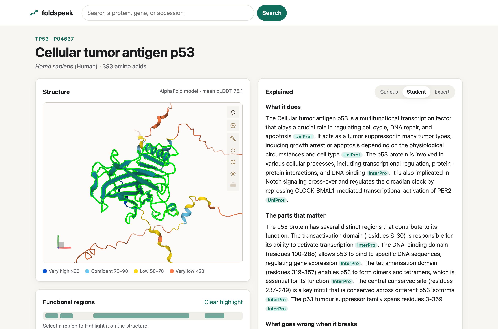

# foldspeak

**An AI guide to any protein on Earth: structure, function, and what breaks it, in plain English.**

**Live:** https://foldspeak.troche.workers.dev



Type a protein name, gene symbol, or UniProt accession. foldspeak returns:

1. **An interactive 3D structure** from AlphaFold DB, coloured by model confidence (pLDDT).
2. **A map of functional regions** from InterPro and UniProt. Click any domain or site to highlight it in 3D.
3. **A layered plain-English explanation** (curious, student, or expert) of what the protein does, which parts matter, and what goes wrong when it breaks.
4. **Citations** back to every database record the explanation used.

The explanation is written by an LLM, but every factual claim comes from a retrieved database record, not from the model's memory. The model's job is explanation, not knowledge.

## Architecture

```
Browser (static assets, Mol* viewer)
   │
   ▼
Cloudflare Worker (TypeScript, Hono)
   ├── Rate Limiting binding   (per-IP, pre-auth)
   ├── Turnstile verification  (LLM path only, after a cache miss)
   ├── KV: PROTEIN_CACHE       (assembled dossiers)
   ├── KV: NARRATION_CACHE     (generated text)
   ├── Durable Object          (daily neuron circuit breaker)
   ├── Workers AI binding      (narration, llama-3.2-3b-instruct)
   └── fetch() → UniProt / AlphaFold / InterPro / PubMed
```

One Worker serves both the API and the static page. Structure and facts render immediately from `GET /api/protein/:acc`. The narration streams in afterwards from `POST /api/narrate`, so someone who only wants the structure never spends an LLM call. The browser fetches the AlphaFold `.cif` directly from EBI, which keeps the Worker and its bandwidth out of the structure path.

| Endpoint | Purpose |
|---|---|
| `GET /api/search?q=` | Free text → UniProt accessions. Reviewed entries first, then exact matches, then human. |
| `GET /api/protein/:accession` | The assembled dossier. `sources` is never empty. |
| `POST /api/narrate` | `{ accession, depth, turnstileToken }` → streamed Markdown. |

Errors share one shape: `{ "error": { "code", "message", "retryAfter?" } }`.

Full design: [docs/spec.md](docs/spec.md). Build plan: [docs/implementation.md](docs/implementation.md).

## Running this costs $0

Everything runs on the Cloudflare Workers **Free** plan, so going over a limit stops the service; it can't produce a bill. The design follows from the two limits that actually bind.

| Resource | Free limit | How foldspeak stays inside it |
|---|---|---|
| Worker requests | 100,000 / day | A protein view is about 3 API calls plus static assets. |
| Worker CPU | 10 ms / request | UniProt is asked for ~20 named fields, not the whole entry (~20 KB parsed instead of ~400 KB). The Worker never parses structure files or PAE matrices: it passes URLs to the browser. |
| **KV writes** | **1,000 / day** | The tightest limit. Every write is best-effort and can fail without failing the request. Nothing per-request (telemetry, counters, sessions) goes to KV. A degraded dossier (an optional source timed out) is not cached. ≈1,000 newly seen proteins a day is plenty for a demo. |
| KV reads | 100,000 / day | 2–3 per page view. |
| Workers AI | 10,000 neurons / day | See below. |
| Durable Objects | SQLite-backed class on Free | One write per LLM call, which KV could not absorb. |
| Turnstile | unlimited | Shown only on a narration cache miss. |

**The neuron arithmetic.** `@cf/meta/llama-3.2-3b-instruct` costs 4,625 neurons per million input tokens and 30,475 per million output tokens. A narration is about 3,000 input and 600 output tokens:

```
3,000 × 4,625 / 1M  =  13.9 neurons
  600 × 30,475 / 1M =  18.3 neurons
                       ─────────────
                       ≈ 32 neurons per fresh narration
10,000 / 32         ≈ 310 fresh narrations per day
```

**The pre-seeded set does most of the work.** The 100 curated proteins ([scripts/curated.json](scripts/curated.json)) are bulk-loaded with their dossiers and student-depth narrations, one time, for about 3,200 neurons. Most demo traffic goes to proteins someone has already seen, and those views cost zero LLM calls and zero KV writes.

**The circuit breaker.** A Durable Object reserves the worst-case cost of each call before making it and reconciles against reported usage afterwards. At 8,000 neurons (configurable) it stops calling the model and shows *"Today's AI budget is used up — cached explanations are still available, and fresh ones resume at midnight UTC."* Cached explanations keep working.

**Measured latency** (live, from a client in the US, network included):

| | Cold (4 upstreams) | Warm (KV hit) |
|---|---|---|
| `GET /api/protein/:acc` | ~1.3 s | ~0.1–0.2 s |

At the edge, a KV hit is about 5 ms of Worker time; the remainder of the warm number is the round trip.

## Abuse controls

Three layers, each with more friction than the last. A normal visitor never sees any of them.

1. **Rate limiting** on every API route: 60/min for browsing, 6/min for narration, keyed on `CF-Connecting-IP`. These limits are per Cloudflare location, so this layer is a cheap filter against casual abuse, not strict prevention.
2. **Turnstile** (managed mode) only when a narration would actually call the model. The narration cache is checked first, so repeat visitors never see a challenge, and the widget script is only downloaded at that point.
3. **The neuron circuit breaker** described above.

"Surprise me" picks only from the curated, pre-seeded set, so it can't be used to drain the budget.

## Grounding and honesty

- The model sees only the retrieved dossier and is told to say "the records don't cover this" rather than fill gaps.
- The dossier is embedded as escaped JSON between `<dossier>` tags. UniProt free text is written by third parties, so `<` and `>` are escaped: no field can close the block or pose as instructions (see [test/prompts.test.ts](test/prompts.test.ts)).
- Each claim must cite a source in the dossier. The page turns `[UniProt]` or `[PubMed 12345]` into links.
- Disease associations are presented as database annotations, never as medical information.
- Model output is HTML-escaped before rendering; only a fixed set of Markdown is converted back to markup.

## Limitations

- **Explanations are AI-generated.** A 3B-parameter model sometimes attributes a fact to the wrong source, adds a general-knowledge sentence, or edges toward a risk statement. Read the citations. Before each release, the narrations for five well-known proteins are read by hand ([docs/release-checklist.md](docs/release-checklist.md)).
- **Not medical advice.** This is not a variant interpretation or clinical tool.
- **Coverage gaps.** AlphaFold DB does not cover every UniProt entry (titin, huntingtin, and very long proteins are common gaps). Those still get a dossier, with a clear "no model" message.
- **Predicted, not experimental, structures.** PDB structures are deferred to a later version.
- **Representative publications** are the PubMed IDs UniProt curators cite as evidence, with up to five shown. This is not a literature search.
- **Small screens** get AlphaFold's predicted-aligned-error image instead of the WebGL viewer, plus a button to load 3D anyway.

## Development

```bash
npm install
npx playwright install chromium
cp .dev.vars.example .dev.vars    # Cloudflare's Turnstile test keys
npm run dev                       # wrangler dev + frontend watcher
```

`wrangler dev` uses local KV and real upstreams. Workers AI always runs remotely, so a narration cache miss in dev spends real neurons.

| Command | What it does |
|---|---|
| `npm run typecheck` | Worker, frontend, e2e, and scripts, each with its own tsconfig |
| `npm test` | Vitest inside workerd against recorded upstream fixtures |
| `npm run e2e` | Playwright (desktop Chrome + Pixel 7) against a seeded `wrangler dev` |
| `npm run deploy` | All three checks, then `wrangler deploy`. Use this, never a bare `wrangler deploy`. |
| `npm run seed` | Bulk-loads the curated dossiers and narrations into production KV. Run once after the first deploy, and again only when the schema version changes. |
| `npx tsx scripts/record-fixtures.ts` | Re-records upstream fixtures from the live services |

**Tests never spend neurons or hit upstreams.** Vitest mocks outbound `fetch` with recorded responses. Playwright seeds dossiers and narrations into local KV, runs the server with `NEURON_DAILY_BUDGET=0` and Cloudflare's Turnstile test keys, and serves Mol* and AlphaFold files locally.

**Secrets** (set with `wrangler secret put`, never committed): `TURNSTILE_SECRET_KEY`, and optionally `NCBI_API_KEY`, which raises E-utilities limits from 3 to 10 requests/second.

## Attribution

foldspeak is built on public goods. Thank you to:

- **[UniProt](https://www.uniprot.org/)**: The UniProt Consortium. Protein sequences, function, features, and disease annotations.
- **[AlphaFold Protein Structure Database](https://alphafold.ebi.ac.uk/)**: EMBL-EBI and Google DeepMind. Predicted structures and confidence.
- **[InterPro](https://www.ebi.ac.uk/interpro/)**: EMBL-EBI. Protein domains and families.
- **[NCBI E-utilities / PubMed](https://pubmed.ncbi.nlm.nih.gov/)**: National Center for Biotechnology Information, U.S. National Library of Medicine. Publication metadata.
- **[Mol\*](https://molstar.org/)**: Structure rendering (Sehnal et al., *Nucleic Acids Research*, 2021).

Each upstream request carries a descriptive `User-Agent` with a link to this repository, and results are cached so the services are never polled in a loop.
